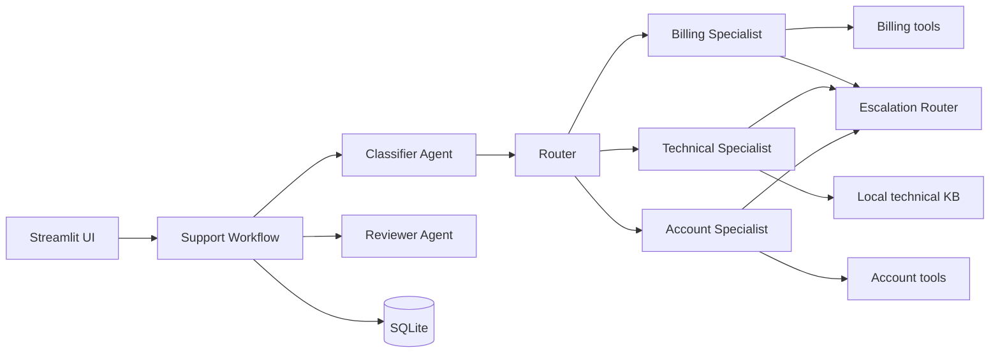

# RelayIt Desk architecture

RelayIt uses a Router-to-Specialists workflow. The classifier normalizes and
classifies a ticket, the router selects exactly one specialist, and the
specialist invokes deterministic Python tools. Technical requests use local
document chunking and lexical retrieval, which is an honest credential-free
fallback for RAG. The escalation router preserves context in SQLite, and the
reviewer checks quality and evidence before release.

Semantic Kernel is listed as the optional framework integration dependency and
is reported in the UI. Deterministic mode is the default and is labelled
clearly; no response is presented as an LLM response when credentials are not
configured.
